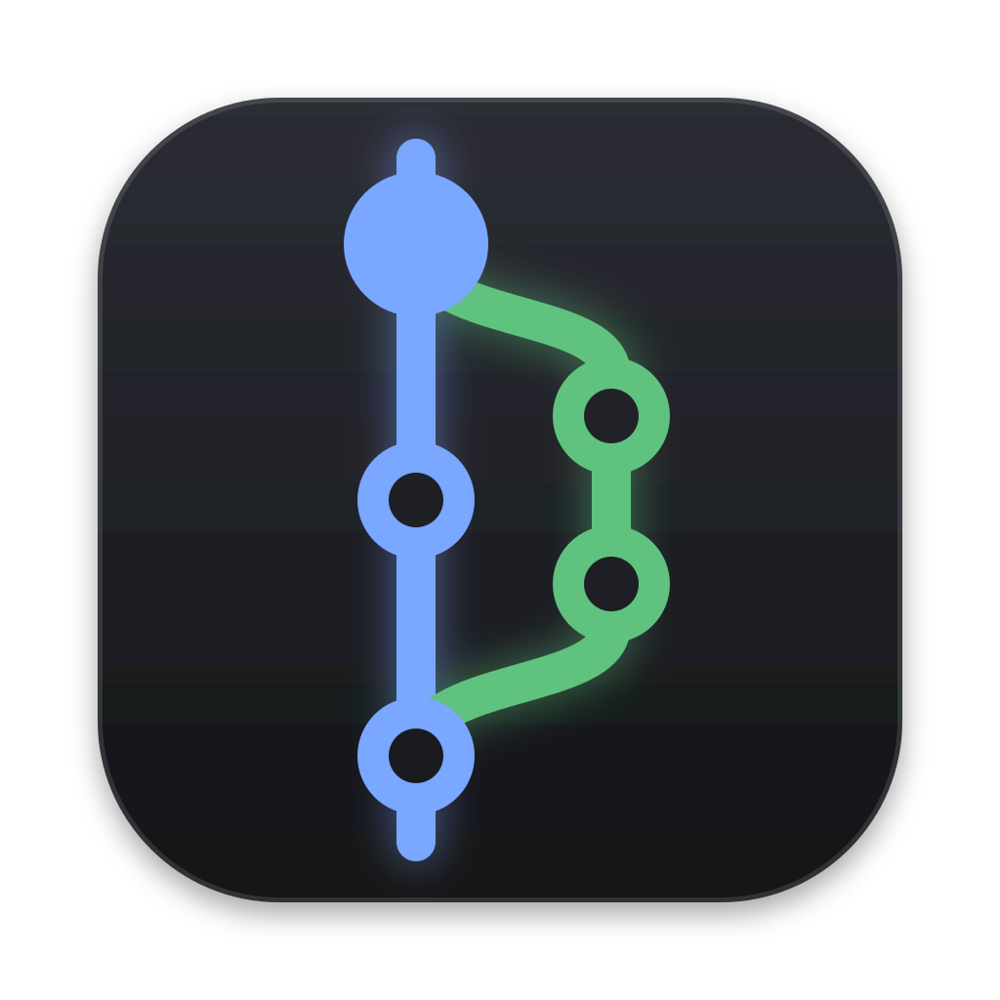

# laziergit

[lazygit](https://github.com/jesseduffield/lazygit) as a desktop GUI, keeping what makes lazygit
fast (one-key actions, everything visible, your keybindings) while adding what a terminal can't do:
real type hierarchy, hairline borders, a full colour palette, a drawn commit graph, hover and mouse.

Built with [MyGo](https://mygo.egoist.dev)'s native UI (Go, GPU-drawn, no webview) on top of
lazygit's own git layer (`pkg/commands`), so git behaviour matches lazygit's.

```sh
go run . /path/to/repo
```

## Compatibility

- Reads your lazygit config (`~/Library/Application Support/lazygit/config.yml`, or `LG_CONFIG_FILE`):
  keybindings, `git.branchLogCmd`, `git.autoFetch`, `refresher.*`, `git.skipHookPrefix`, ...
- Keys are matched the way lazygit means them: `?`, `<`, `@` are characters, whatever your layout;
  `<c-r>`/`<a-…>` are Ctrl/Option chords. Cmd is left to macOS.
- Credential prompts from git (HTTPS username/password, SSH passphrases) open in-app.

## What works

| Area | Keys (defaults) |
| --- | --- |
| Panels, navigation | `1`–`5`, `h`/`l`, `j`/`k`, `<`/`>`, `,`/`.`, `0` focus main, `esc` back |
| Files | `space` stage, `a` stage all, `enter` stage lines, `d` discard, `c` commit, `w` commit without hooks, `A` amend, `s` stash, `f` fetch |
| Staging | `space` stage/unstage, `v` range, `a` hunk, `tab` staged/unstaged, `d` discard |
| Branches | `space` checkout, `n` new, `c` checkout by name, `d` delete |
| Commits | `enter` view files, `s` squash down, `f` fixup down, `r` reword, `i` rebase controls, Ctrl+`j`/`k` reorder, `C` copy, `V` cherry-pick |
| Conflicts | `space` or `enter` opens top/bottom/both, whole-file, manual and delete resolutions; `@` → continue/abort |
| Branch tabs | `[` / `]` or click Branches / Remotes / Tags; `space` checks out a tag (detached HEAD), `f` fetches in Remotes |
| Undo | `z` previews undo of the latest supported reflog action; commit changes remain staged |
| Stash | `space` apply, `g` pop, `d` drop |
| Sync | `P` push (prompts for upstream; force-with-lease when diverged), `p` pull |
| Everything else | `?` keybindings menu (`/` to filter), `@` command log |

## Notes

- Squash keeps both messages; fixup keeps the parent's. Rewrites require confirmation.
- Resolve repeated conflicts with `space`; the file stages after the last resolution.
- During rebase, “ours” is the rebased branch; “theirs” is the replayed commit.
- Copy commits before switching branches. Cherry-pick applies them in copy order.
- Undo preserves local edits where possible. It cannot recover discarded edits, deleted branches or dropped stashes.
- Custom commands support templates, nested menus, input/confirm/menu/menuFromCommand prompts, and popup/log output.

## Limitations

- Custom commands: terminal integration, suggestions, ANSI colour templates and some session properties.
- Remotes/tags: inspection, fetch and tag checkout only; use custom commands for management.
- Redo is not yet supported.

## Development

```sh
go test ./...                                   # headless UI tests drive real keypresses and git
SHOT_DIR=/tmp/shots go test ./internal/app -run TestShots   # screenshots for visual review
PERF_REPO=/path/to/big/repo go test ./internal/app -run TestPerf -v
LAZIERGIT_KEYS="4 <enter>" LAZIERGIT_CAPTURE=out.png go run . /path/to/repo   # capture the real window
```
