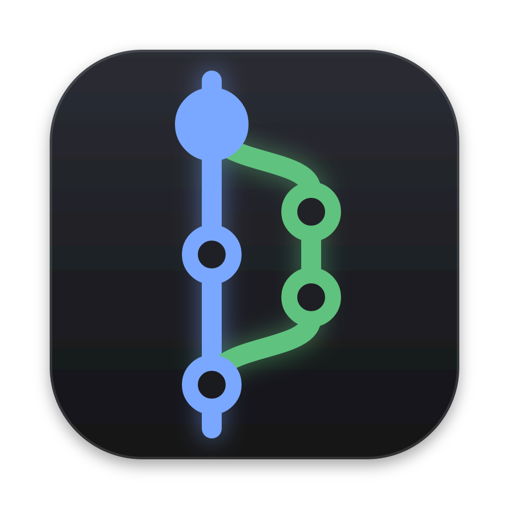
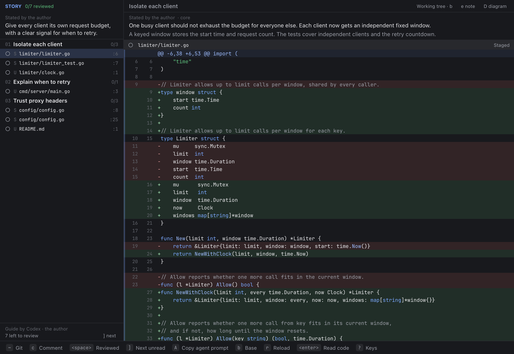
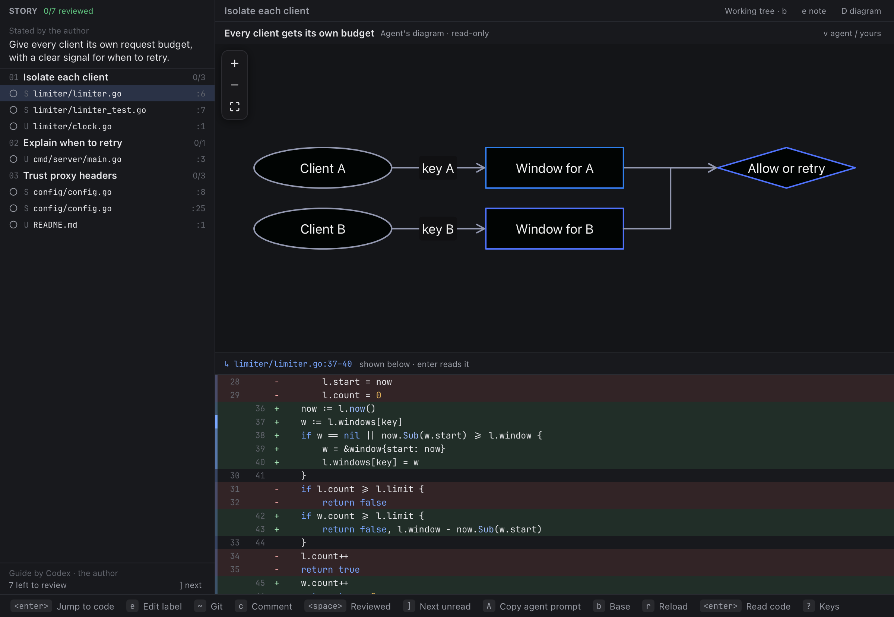
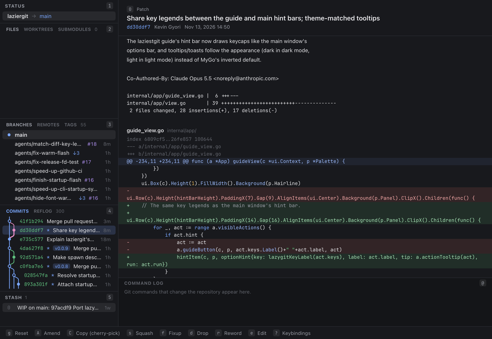

# laziergit

[lazygit](https://github.com/jesseduffield/lazygit) as a native desktop app, with a
Linear-inspired diff guide for understanding changes.

The aim is to keep what makes lazygit fast: one-key actions, familiar panels,
your config and keybindings. A graphical interface adds a drawn commit graph,
clearer typography, and mouse interaction. Built in Go with
[MyGo](https://mygo.egoist.dev), on top of lazygit's own Git layer.

## Read the change as a story

The experimental diff guide groups changes across files by intent, pairing code
with explanations of what changed and why. Implementation and tests can sit in
the same section, so you can follow a behavior through the change instead of
piecing it together file by file.

Connect your coding agent over MCP to write the guide. Review the explanations
against the syntax-highlighted diffs, mark hunks as reviewed, and send comments
back to the agent. Press **~** to switch between the guide and the Git view,
keeping your place in each.



Guides can also include flow and sequence diagrams linked to the code. Press
**D** to open a section's diagram; selecting a node or message highlights the
corresponding lines below. Edit the diagram to propose a different flow and send
your changes back to the agent alongside review comments.



[Guide setup and controls](docs/LAZIESTGIT.md).

## Keep your lazygit workflow

Stage individual lines or hunks, commit, browse branches and history, rebase,
and resolve conflicts using lazygit's keyboard grammar. Your lazygit config and
keybindings work here too (`LG_CONFIG_FILE` or the standard config location).
Git credential prompts open in-app; Cmd shortcuts stay with macOS.



Matching lazygit's behavior is the goal, tested against lazygit's own integration
suite. The detailed [parity report](parity/STATUS.md) tracks coverage and remaining gaps.

## Try it

On macOS, download the DMG from [Releases](https://github.com/kevingyori/laziergit/releases),
drag the app into Applications, and open it. Choose
**laziergit → Install Command Line Tool…** (Cmd+Shift+L) to install
`/usr/local/bin/laziergit`; macOS asks for administrator permission if needed.
Keep the app in place after installation, and ensure `/usr/local/bin` is on your PATH.

Run `laziergit` inside a Git repository, or `laziergit /path/to/repo`.
Opening the app from Finder prompts you to choose a repository.

To run from source:

```sh
go run . /path/to/repo
```

Press **~** to open the diff guide, or start there with:

```sh
go run . --guide /path/to/repo
```

## Development

```sh
go test ./...                                   # headless UI tests drive real keypresses and git
SHOT_DIR=/tmp/shots go test ./internal/app -run TestShots   # screenshots for visual review
PERF_REPO=/path/to/big/repo go test ./internal/app -run TestPerf -v
LAZIERGIT_KEYS="4 <enter>" LAZIERGIT_CAPTURE=out.png go run . /path/to/repo   # capture the real window
```
